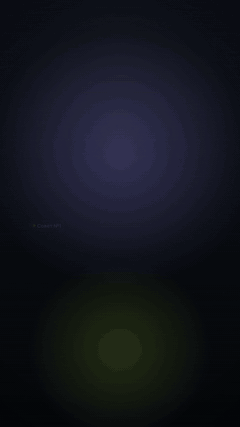

# vertical-motion-kit

Анимации для вертикальных роликов (1080×1920) на **Remotion + React + TypeScript** и скрипт на **Python + ffmpeg**, который вырезает паузы из видео с телефона.



## Что внутри

| Сцена | Что показывает |
| --- | --- |
| `Hook` | заголовок-хук: слова выезжают на пружине, ключевое слово подчёркивает маркер |
| `Captions` | субтитры по словам, как после распознавания речи: активное слово подсвечивается |
| `ListCard` | стеклянная карточка-чек-лист, пункты появляются по очереди, галочки рисуются |
| `Timer` | кольцо обратного отсчёта, последние секунды — красным с пульсом и тиканьем |
| `Stat` | счётчик с ростом и столбики |
| `SafeZone` | элементы, которые «хотели» встать на лицо, сами уходят из зоны лица |
| `Outro` | финальная карточка |

Все сцены собраны в один ролик `Showreel` с переходами и звуками (свист на переходах, «поп» на пунктах списка, тиканье таймера). Каждую сцену можно открыть и править отдельно в Remotion Studio.

## Ничего не закрывает лицо

Зона лица задана в `src/theme.ts` (`FACE`): на вертикальном видео с телефона лицо почти всегда в верхней-средней части кадра. Функция `avoidFace` в `src/safeZone.ts` выносит любой элемент из этой зоны по кратчайшему пути: вверх, вниз, влево или вправо. При этом элемент не выходит за кадр и не налезает на уже поставленные. `placeAll` раскладывает сразу несколько элементов. Сцена `SafeZone` показывает это наглядно.

## Вырезание пауз (Python + ffmpeg)

```bash
python tools/cut_pauses.py input.mp4 output.mp4
python tools/cut_pauses.py input.mp4 output.mp4 --noise -32 --min-pause 0.35 --json cuts.json
python tools/cut_pauses.py --selftest
```

Как работает:

1. `silencedetect` находит тишину тише порога.
2. Между паузами остаётся речь с небольшим запасом по краям, чтобы не обрезать начало и конец слов.
3. Слишком короткие куски выбрасываются, близкие склеиваются.
4. Всё собирается одним проходом `trim` + `concat` с микро-затуханием звука на стыках, без щелчков.

`--json` сохраняет оставленные отрезки: по ним можно пересчитать тайминги слов для субтитров. Нужны только `ffmpeg` и `ffprobe`, Python 3.10+, без сторонних библиотек.

## Запуск

```bash
npm install
npm run studio        # Remotion Studio в браузере: все сцены, правка в реальном времени
npm run render        # out/showreel.mp4
npm run typecheck     # проверка типов TypeScript
```

### Поверх своего видео

1. Положите вертикальное видео в `public/input.mp4`.
2. Скопируйте `props.example.json` в `props.json`.
3. Запустите `npm run render:video`.

Без видео рисуется тёмный фон.

## Структура

```
src/
  Root.tsx           композиции: Showreel и каждая сцена отдельно
  Showreel.tsx       сборка сцен, переходы, звуки
  theme.ts           цвета, шрифты, зона лица
  safeZone.ts        avoidFace / placeAll — раскладка вне зоны лица
  fonts.ts           загрузка шрифтов из public/fonts (рендер не зависит от интернета)
  components/        фон, стеклянная карточка, плашка, переход scaleBlur
  scenes/            Hook, Captions, ListCard, Timer, Stat, SafeZone, Outro
tools/cut_pauses.py  вырезание пауз
public/fonts         Unbounded, Manrope (SIL Open Font License)
public/sfx           звуки, синтезированы в ffmpeg (без чужих сэмплов)
```

Стек: Remotion 4, React 18, TypeScript, @remotion/transitions, Python 3, ffmpeg.
